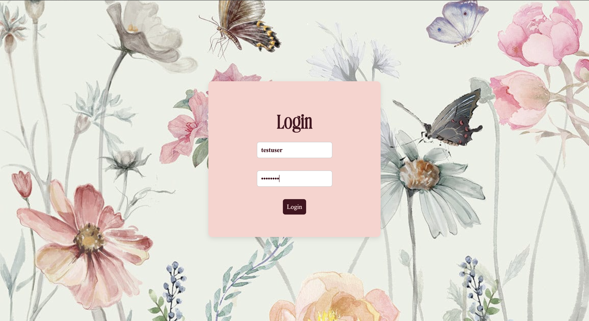
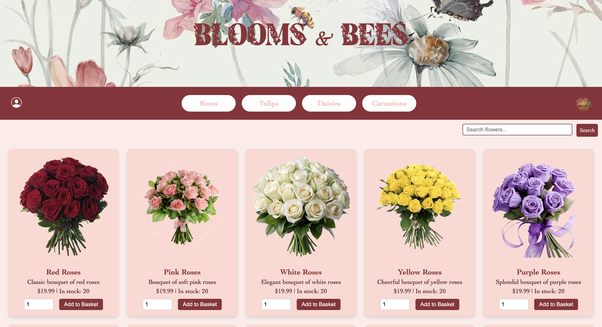
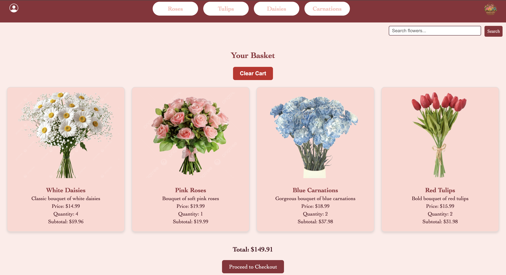
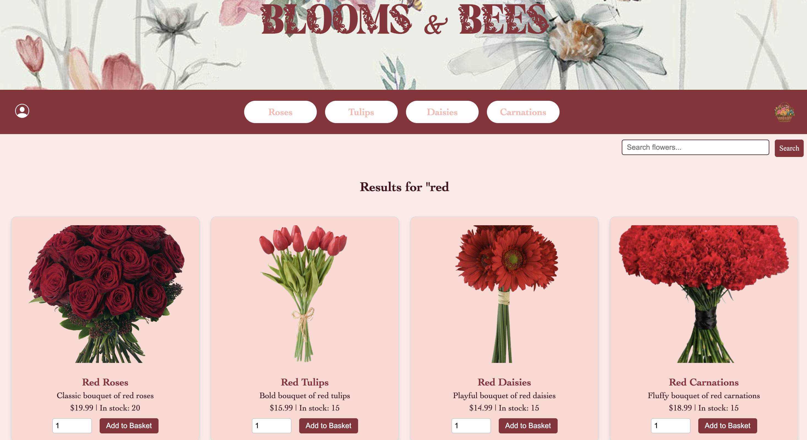

<div align="center">

# Flower Shop

**A full-stack e-commerce web app for an online flower store: browse bouquets, search, fill a cart, and check out with live inventory updates.**


</div>

---

## Overview

Flower Shop is a web store built from scratch with Flask and SQLite. Shoppers can browse **24 bouquets** across **4 categories** (Roses, Tulips, Daisies, and Carnations), search by name, and see live price and stock. Logged-in users can build a cart, check out, and review their order history. Inventory is only reduced when an order is placed.


<p align="center">
  
  
  
  
</p>


## Features

**Shopping**
- Browse all products, or filter by category from the navigation bar
- Search products by name with case-insensitive partial matching
- Product cards with image, description, price, and quantity in stock

**Accounts**
- Sign up with a username, password, and first and last name, with duplicate-username checks
- Log in and log out with session-based authentication
- Visitors can browse freely, but only logged-in users can add to the cart or check out

**Cart and checkout**
- The cart is stored in the **Flask session**, not the database, so it costs nothing until checkout
- View the cart with per-item subtotals and an order total, or clear it in one click
- **Checkout is a single database transaction**: it creates the order and its line items, and decrements stock for each product
- Creates a unique 12-digit order number for each purchase

**Input validation**
- **Client side:** quantity inputs are bounded to 1 through the available stock, and JavaScript blocks invalid submissions
- **Server side:** checkout re-checks stock against the database and rejects the order if any item exceeds what's available, so the cart can't oversell

**Order history**
- See every past order with its date, order number, items, quantities, subtotals, and total
- Orders are sorted newest first

## Database Design

`store_schema.sql` creates and seeds four tables:

| Table | Purpose |
| --- | --- |
| `users` | Username (primary key), password, first and last name |
| `products` | Name, description, category, price, quantity in stock, and image path |
| `orders` | One row per checkout: user, total, timestamp, and unique order number |
| `order_items` | Line items linking orders to products, with quantity and subtotal |

Foreign keys connect `orders → users` and `order_items → orders / products` with cascading updates and deletes. All queries use **parameterized SQL**.

## Tech Stack

| Layer | Tools |
| --- | --- |
| Backend | Python, Flask (routing, sessions, flash messages) |
| Database | SQLite |
| Frontend | Jinja2 templates, HTML, CSS (custom fonts), JavaScript |

## Getting Started

### Prerequisites
- Python 3.9+
- `sqlite3` command-line tool (preinstalled on macOS)

### Setup

```bash
# 1. Clone the repo
git clone https://github.com/hadya584/flower-shop.git
cd flower-shop

# 2. Create a virtual environment and install Flask
python3 -m venv .venv
source .venv/bin/activate        # Windows: .venv\Scripts\activate
pip install flask

# 3. (Optional) Reset the database to its starting inventory
sqlite3 store.db < store_schema.sql

# 4. Run the app
python main.py
```

Then open **http://localhost:8080**.

**Demo login:** username `testuser`, password `testpass`, or create a new account on the sign-up page.

## Project Structure

```
flower-shop/
├── main.py              # Flask app: routes for browsing, auth, cart, checkout, and order history
├── store_schema.sql     # Schema + seed data (test user, 24 products)
├── store.db             # SQLite database
├── templates/           # index, category, search, cart, order_history, login, signup
└── static/              # CSS, custom fonts, and product images
```

## Design Decisions

- **Inventory is reduced at checkout, not when items are added to the cart**, so abandoned carts never lock up stock.
- **Stock is validated twice.** The browser check gives instant feedback, and the server check at checkout is the source of truth, because browser checks can be bypassed.
- **Each order stores line-item subtotals** at the price paid, so order history stays accurate even if product prices change later.
